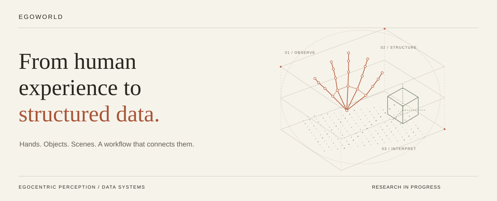
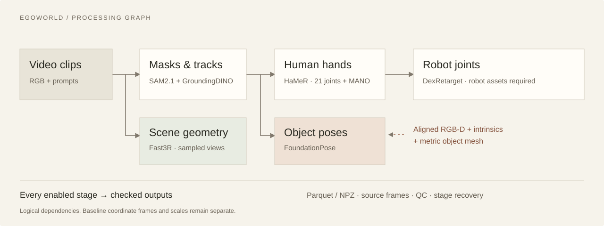

<div align="center">

# EgoWorld

**Structured data from human experience.**

An offline annotation toolkit for egocentric video, built around hands, objects, and scenes.

[Overview](#from-video-to-usable-data) · [Quick start](#quick-start) · [Insights](docs/en/insights.md) · [Research plan](docs/en/research-plan.md) · [Documentation](docs/en/README.md)

</div>



## From video to usable data

EgoWorld connects perception models into a configurable workflow for preparing research datasets. Extract masks and tracks, reconstruct hands, estimate object poses, retarget robot joints, and recover scene geometry—with explicit source frames, output contracts, and stage-level recovery.

**The aim is simple:** make expensive predictions easier to reuse, inspect, and interpret.

| Choose the work | Keep completed work | Understand the result |
| --- | --- | --- |
| Enable the annotation branches your dataset needs. | Resume valid stages after an interrupted run. | Inspect structured outputs, quality checks, and an offline run report. |

> **Research software · actively developed.** This branch integrates five annotation stages, output recipes, verified caches, replay, GPU probes, and optional CPU/GPU phase execution. See the [status ledger](docs/en/status.md) and [local validation](docs/throughput-validation.md) for evidence and limits. Throughput gains and downstream learning improvements remain research questions.

## One workflow, several views



*Processing diagram, not an inference result. Object pose requires aligned RGB-D, intrinsics, and a metric mesh. Robot retargeting requires robot assets. Baseline outputs retain separate coordinate frames and scales.*

| Output | Component | What it provides |
| --- | --- | --- |
| **Masks & tracks** | SAM2.1 + GroundingDINO | Instance masks, labels, boxes, and clip-local 2D trajectories |
| **Human hands** | HaMeR | Handedness, 21 joints, rotations, and MANO shape parameters |
| **Object poses** | FoundationPose | Object-to-camera position and orientation from RGB-D and mesh assets |
| **Robot joints** | DexRetarget | Named joint values with robot identity and units |
| **Scene geometry** | Fast3R | Sampled-view cameras, intrinsics, and a point cloud; relative scale by default |

Explore the [illustrated output guide](docs/assets/architecture.svg) or the [architecture and coordinate contracts](docs/en/architecture.md). Models require their own weights and runtime environments.

## Ideas driving the project

**01 / Start with the data you need.** Researchers usually want hand joints or object trajectories, not a particular execution graph. The developing recipe layer translates requested outputs into shared model work.

**02 / Reuse must be earned.** A cache hit is useful only when inputs, model assets, parameters, and upstream results still match. Verification cost and the scope of invalidation are part of the performance problem.

**03 / A timestamp is not a world frame.** Associating predictions by source frame does not make their coordinates metrically compatible. Scale, calibration, and transform direction must remain explicit.

**04 / Measure useful work.** Optimize accepted output per second while tracking quality, memory, queueing, and recovery. A faster run that silently drops frames answers a different question.

[Read the insights →](docs/en/insights.md) · [Explore the research agenda →](docs/en/research-plan.md)

## Quick start

Use Linux, an NVIDIA GPU, and Conda for real-model inference. Begin with segmentation and a short video; other branches require separate environments and assets. Hardware fit depends on the model and workload.

```bash
git clone https://github.com/LyrineYang/egoworld.git
cd egoworld
bash egoworld/scripts/setup_env.sh --weights
conda activate egoworld-base
mkdir -p config.local
cp egoworld/configs/example.json config.local/job.json
```

Edit `config.local/job.json` for model paths, prompts, and output directory, then check and run:

```bash
egoworld launch --config config.local/job.json --input-dir /absolute/videos --check-only
egoworld doctor --config config.local/job.json --gpu --assets
egoworld smoke --config config.local/job.json --input-video /absolute/videos/sample.mp4
egoworld launch --config config.local/job.json --input-dir /absolute/videos --run-id first_run
```

Repeat the same launch command to resume an unchanged run. Inspect using the configured output root:

```bash
egoworld inspect --run-dir /absolute/output/run_id=first_run
egoworld report --run-dir /absolute/output/run_id=first_run
```

Open the generated `report.html` to explore timings, clip QC, failures, and row counts. It works offline and does not rerun models or certify annotation accuracy.

[Full English walkthrough →](docs/en/getting-started.md) · [Detailed server guide 中文 →](docs/server.md)

## A dataset you can inspect

Annotations use Parquet, scene points use NPZ, and runs retain manifests, quality checks, and execution records.

```text
run_id=first_run/
├── run_summary.json
├── events.jsonl
└── video_id=…/clip_id=…/
    ├── masks.parquet · instances.parquet · tracks.parquet
    ├── hand_pose.parquet · object_pose.parquet · mapping.parquet
    ├── reconstruction.parquet · reconstruction-pointcloud.npz
    └── qc.json · meta.json
```

Only enabled stages produce associated outputs. Use `egoworld schema` for field definitions and `egoworld plan --config config.local/job.json` for dependencies.

## Choose the data you need

Output recipes select data types, include shared model kernels, and reuse verified stage outputs across runs. Run `egoworld data catalog` or see the [recipe and coordinate guide](docs/data-recipes.md). Calibrated world outputs require metric scale evidence and compatible coordinate frames.

## Research, with an evidence trail

The core research goal is **more complete and efficient cleaning and processing of embodied data than general-purpose systems such as Data-Juicer**, evaluated with the same inputs, model behavior, output requirements, and cleaning rules. Superiority remains a hypothesis. The next phase focuses on **quality-preserving efficiency**: less repeated identity checking and decoding, bounded intermediate data, better model reuse, and explainable filtering. New model families are not the immediate priority.

| Workstream | Next question |
| --- | --- |
| Reuse & input preparation | When do verified caches save more time than they cost? |
| Resource-aware scheduling | Can measured load costs and memory pressure improve throughput without starving branches? |
| Quality & geometry | Which outputs are usable, and which require calibration or review? |
| Reproducible evaluation | How do execution strategies compare with identical models, inputs, and quality requirements? |

CPU and Ray regression records and short real-model runs on an 8 GB RTX 4060 Laptop are available for this branch, including a separate RGB-D/mesh example. Optional [phase execution and cost calibration](docs/throughput-execution.md) have [local throughput measurements](docs/throughput-validation.md); these do not establish an advantage over another framework. Large-scale throughput, multi-GPU scaling, automatic handedness, and downstream learning gains are not established. See the [evidence ledger](docs/en/status.md).

## Explore further

| Project | Engineering |
| --- | --- |
| [Insights and design rationale](docs/en/insights.md) | [Architecture and contracts](docs/en/architecture.md) |
| [Research plan and experiments](docs/en/research-plan.md) | [Getting started](docs/en/getting-started.md) |
| [Website direction and visual system](docs/website-design.md) | [Output reference 中文](docs/outputs.md) |
| [Local website prototype](website/README.md) | [Test records 中文](docs/testing.md) |

**Acknowledgments.** Built on [SAM2](https://github.com/facebookresearch/sam2), [GroundingDINO](https://github.com/IDEA-Research/GroundingDINO), [HaMeR](https://github.com/geopavlakos/hamer), [FoundationPose](https://github.com/NVlabs/FoundationPose), [dex-retargeting](https://github.com/dexsuite/dex-retargeting), and [Fast3R](https://github.com/facebookresearch/fast3r). Models and assets retain upstream licenses and access requirements. A license for EgoWorld itself has not yet been selected.
