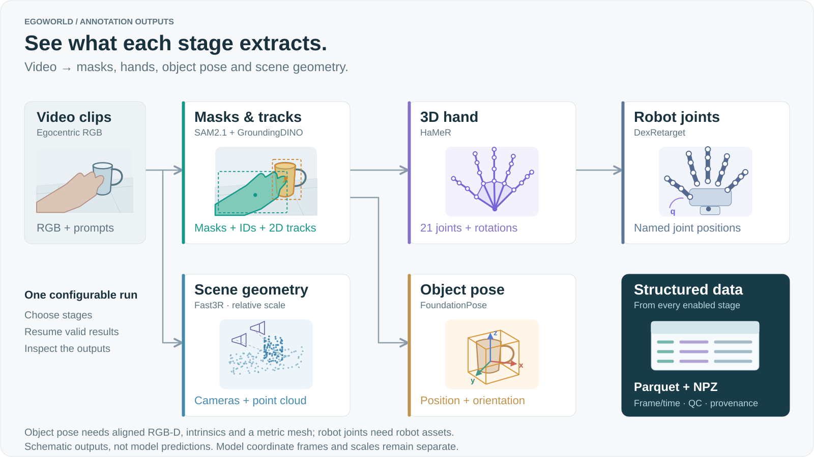

<div align="center">

# EgoWorld

**Turn egocentric video into structured hand, object, and scene data.**

Choose annotations. Recover interrupted work. Inspect the resulting data.

[](https://github.com/LyrineYang/egoworld/actions/workflows/tests.yml)
[](pyproject.toml)

[Why EgoWorld](#why-egoworld) · [Capabilities](#capabilities) · [Quick start](#quick-start) · [Validation](#validation) · [中文项目解读](docs/overview.md#7-项目定位工程贡献与研究-insight)

</div>

EgoWorld is a configurable **offline annotation pipeline** for egocentric video. It connects segmentation, hand pose, object pose, robot hand retargeting, and scene geometry with source timestamps, explicit output contracts, and recovery at each stage.

Designed for researchers preparing hand–object–scene data on a single NVIDIA server. Start with RGB segmentation; add branches when the required model and data assets are available.



*Pictures show the outputs; model names are secondary labels. Illustrations, not real predictions. Object pose requires aligned RGB-D, intrinsics and a metric mesh; retargeting requires robot assets. Coordinate frames and scales remain separate.*

## Why EgoWorld

The engineering contribution is the path from model predictions to a recoverable, inspectable dataset. The perception models remain upstream components.

| Practical problem | EgoWorld's design | What this enables |
| --- | --- | --- |
| A dataset needs different annotations on limited hardware | Configurable branches, isolated model environments, model reuse, bounded scheduling | Select supported outputs and control in-flight work within one workflow |
| One expensive stage fails after others finish | Per-stage commits, schema/hash validation, dependency-aware invalidation | Reuse valid stages and rebuild affected descendants; preserve independent branches |
| Models disagree about formats, frames, and scale | Shared output contracts with source frame/time and explicit coordinate, unit, and scale fields | Join annotations by source frame and interpret their geometry correctly |

**Research focus: scheduling under model-switch and resource costs.** The current scheduler combines completion events, model reuse, waiting protection, and bounded admission. The next question is whether measured switching costs, stage durations, and intermediate-data pressure can improve useful throughput over these fixed heuristics while preserving output quality and recovery. This is proposed research; target-hardware gains have not been established. See the [comparison and validation method](docs/design.md#11-调度作为突破点研究问题与验证方法).

**Design insight: time alignment and geometry alignment are different problems.** Source frame indices let you associate observations across stages. A shared metric world frame still requires calibration and scale alignment. EgoWorld records the existing conventions so downstream work can make that distinction. See the [engineering rationale and research opportunities](docs/overview.md#7-项目定位工程贡献与研究-insight).

The [development handoff](docs/handoff.md#文件结构与阅读地图) maps the existing files to their contents, including gap resolution, alignment steps, scheduling research, and validation.

<details>
<summary><strong>Explore the annotation outputs — illustrated model-by-model overview</strong></summary>


Illustrations, not real-model predictions. File names, required inputs, and coordinate meanings are explained below and in the [output reference](docs/outputs.md).

</details>

## Capabilities

| Annotation | Model / component | What you get | Required input |
| --- | --- | --- | --- |
| **Segmentation & tracking** | SAM2.1 + GroundingDINO | Hand/object masks, labels, clip-local IDs, 2D boxes and center trajectories | RGB video, text prompts |
| **3D hand pose** | HaMeR | Handedness, 21 joints, wrist and finger joint rotations, hand shape | RGB and detected hand boxes; HaMeR/MANO assets |
| **6D object pose** | FoundationPose | Object position and orientation relative to the camera | Aligned RGB-D, camera intrinsics, metric object mesh |
| **Robotic hand retargeting** | DexRetarget | Named robot joint angles or displacements | 3D hand joints, robot configuration and URDF |
| **Scene geometry** | Fast3R | Sampled-view camera poses, intrinsics, point cloud | Multiple RGB frames; relative scale by default |

Each enabled model requires its weights and runtime dependencies. FoundationPose and retargeting are optional when their inputs or robot assets are unavailable. Outputs retain their own reference frames; they are not fused into a shared world coordinate system. See the [output reference](docs/outputs.md) for exact meanings and units.

## Quick start

Use a Linux NVIDIA server with Conda. Run the commands below from the repository root. The [setup guide](docs/server.md) covers CUDA dependencies, model assets, and configuration.

**1. Install and choose a configuration.**

```bash
bash egoworld/scripts/setup_env.sh --weights
conda activate egoworld-base
mkdir -p config.local
cp egoworld/configs/example.json config.local/job.json
```

The starter configuration enables SAM2.1 + GroundingDINO. Edit `job.json` to set model paths, target prompts, and output locations. The installer downloads the segmentation weights; additional stages require their own [model environments and assets](egoworld/env/README.md).

| Configuration | Use case |
| --- | --- |
| [example.json](egoworld/configs/example.json) | Start with segmentation and 2D tracking |
| [rgb.json](egoworld/configs/rgb.json) | Add hand pose, robotic hand retargeting, and scene geometry |
| [full.json](egoworld/configs/full.json) | Also estimate object pose from existing RGB-D and mesh assets |
| [server.json](egoworld/configs/server.json) | Shared GPU pool for 2–16 GPU servers; four-GPU starting configuration |

**2. Check the setup and run a short sample.**

```bash
egoworld launch --config config.local/job.json --input-dir /absolute/videos --check-only
egoworld doctor --config config.local/job.json --gpu --assets
egoworld smoke --config config.local/job.json --input-video /absolute/videos/sample.mp4
```

The smoke test runs the enabled stages and checks that a second run reuses completed outputs. For a 16 GB GPU, see the [conservative smoke profile and hardware requirements](docs/server.md#7-16gb-单卡-smoke).

**3. Process a directory and inspect the results.**

```bash
egoworld launch --config config.local/job.json --input-dir /absolute/videos --run-id dataset_001
egoworld inspect --run-dir /absolute/output/run_id=dataset_001
egoworld report --run-dir /absolute/output/run_id=dataset_001
```

Replace `/absolute/output` with the configured `paths.output_root`. To resume, repeat the same launch command with the same configuration and run ID. Use a new run ID when code, models, inputs, or processing settings change.

Open the generated `report.html` in a browser for an **offline inspection report**: stage timing, searchable clip QC, failed or incomplete outputs, and per-stage file row counts. No GPU, model runtime, web server, or network connection is needed. It reads existing run records and checks commit metadata; it does not rerun inference or certify annotation accuracy. Reports include at most 1,000 clip details by default (`--max-clips` changes the limit), and clearly mark partial coverage. See the [inspection guide](docs/server.md#离线可视化报告) for details.

## Output format

Annotations are written as **Parquet tables**, with scene point clouds in **NPZ**. Each clip includes quality checks and metadata; each run includes an execution summary and event log.

```text
run_id=dataset_001/
├── run_summary.json
├── events.jsonl
└── video_id=…/clip_id=…/
    ├── masks.parquet · instances.parquet · tracks.parquet
    ├── hand_pose.parquet · object_pose.parquet · mapping.parquet
    ├── reconstruction.parquet · reconstruction-pointcloud.npz
    └── qc.json · meta.json
```

Only enabled stages produce annotations. Use `egoworld schema` to inspect field definitions and `egoworld plan --config config.local/job.json` to view stage dependencies. A completed run confirms execution; its quality reports and sampled annotations still need review.

## Documentation

The detailed guides are currently maintained in Chinese.

| Guide | Contents |
| --- | --- |
| [Server guide](docs/server.md) | Installation, configuration, processing, recovery, and troubleshooting |
| [Output reference](docs/outputs.md) | Model-to-output mapping, coordinate frames, units, and required assets |
| [Architecture](docs/design.md) | Scheduling, resource limits, stage commits, and throughput design |
| [Testing](docs/testing.md) | CPU checks, Ray integration, real-model smoke tests, and verification boundaries |
| [Requirements](docs/requirements.md) | Supported scope and its implementation and test coverage |

## Validation

| Evidence | Current status |
| --- | --- |
| CPU data flow, contracts, fault recovery, CLI and offline reports | Local regression passed; see [test scope and records](docs/testing.md) |
| Real Ray processes with model test doubles | Previously passed locally; these checks do not run CUDA inference |
| Real-model inference and annotation quality | Target-hardware validation pending |
| 16 GB fit, multi-GPU scaling and server throughput | Configuration templates available; target-hardware measurements pending |

The current contribution is an integration and execution system. New perception algorithms, a fused metric world representation, and downstream robot-learning gains would require separate evidence.

**Licensing.** A project license has not yet been specified. Integrated models and assets remain subject to their respective upstream licenses.
