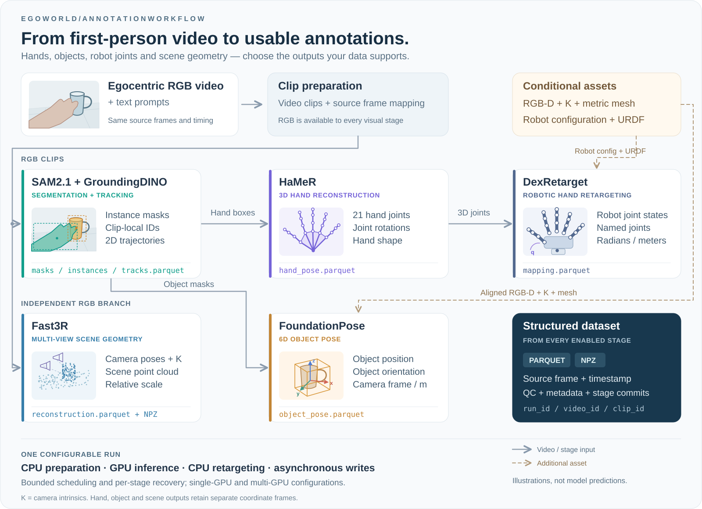

<div align="center">

# EgoWorld

**Turn egocentric video into structured hand, object, and scene data.**

Composable annotations. Resumable processing. Inspectable datasets.

[](https://github.com/LyrineYang/egoworld/actions/workflows/tests.yml)
[](pyproject.toml)

[Quick start](#quick-start) · [Capabilities](#capabilities) · [Output format](#output-format) · [Documentation](#documentation)

</div>



*Workflow and output illustrations. Examples are schematic, not real-model predictions; each model retains its own coordinate frame.*

EgoWorld brings segmentation, hand reconstruction, object pose estimation, robotic hand retargeting, and scene reconstruction into one command-line workflow. Configure the stages your data supports, process a video directory, and export results with timestamps, coordinate conventions, and quality checks.

Built for offline batch processing on a single NVIDIA server:

- **Compose the pipeline.** Enable the annotations you need, with separate model environments where dependencies differ.
- **Resume interrupted work.** Reuse validated stage outputs and retry failed work without restarting the entire dataset.
- **Inspect every run.** Read structured outputs, quality reports, logs, and records of the inputs, models, and configuration used.

## Capabilities

| Annotation | Model / component | What you get | Required input |
| --- | --- | --- | --- |
| **Segmentation & tracking** | SAM2.1 + GroundingDINO | Hand/object masks, labels, clip-local IDs, 2D boxes and center trajectories | RGB video, text prompts |
| **3D hand pose** | HaMeR | Handedness, 21 joints, wrist and finger joint rotations, hand shape | RGB and detected hand boxes; HaMeR/MANO assets |
| **6D object pose** | FoundationPose | Object position and orientation relative to the camera | Aligned RGB-D, camera intrinsics, metric object mesh |
| **Robotic hand retargeting** | DexRetarget | Named robot joint angles or displacements | 3D hand joints, robot configuration and URDF |
| **Scene geometry** | Fast3R | Sampled-view camera poses, intrinsics, point cloud | Multiple RGB frames; relative scale by default |

Each enabled model requires its weights and runtime dependencies. FoundationPose and retargeting are optional when their inputs or robot assets are unavailable. Outputs retain their own reference frames; they are not fused into a shared world coordinate system. See the [output reference](docs/outputs.md) for exact meanings and units.

## Quick start

Use a Linux NVIDIA server with Conda. Run the commands below from the repository root. The [setup guide](docs/server.md) covers CUDA dependencies, model assets, and configuration.

**1. Install and choose a configuration.**

```bash
bash egoworld/scripts/setup_env.sh --weights
conda activate egoworld-base
mkdir -p config.local
cp egoworld/configs/example.json config.local/job.json
```

The starter configuration enables SAM2.1 + GroundingDINO. Edit `job.json` to set model paths, target prompts, and output locations. The installer downloads the segmentation weights; additional stages require their own [model environments and assets](egoworld/env/README.md).

| Configuration | Use case |
| --- | --- |
| [example.json](egoworld/configs/example.json) | Start with segmentation and 2D tracking |
| [rgb.json](egoworld/configs/rgb.json) | Add hand pose, robotic hand retargeting, and scene geometry |
| [full.json](egoworld/configs/full.json) | Also estimate object pose from existing RGB-D and mesh assets |
| [server.json](egoworld/configs/server.json) | Explore stage assignment across four GPUs |

**2. Check the setup and run a short sample.**

```bash
egoworld launch --config config.local/job.json --input-dir /absolute/videos --check-only
egoworld doctor --config config.local/job.json --gpu --assets
egoworld smoke --config config.local/job.json --input-video /absolute/videos/sample.mp4
```

The smoke test runs the enabled stages and checks that a second run reuses completed outputs. For a 16 GB GPU, see the [conservative smoke profile and hardware requirements](docs/server.md#7-16gb-单卡-smoke).

**3. Process a directory and inspect the results.**

```bash
egoworld launch --config config.local/job.json --input-dir /absolute/videos --run-id dataset_001
egoworld inspect --run-dir /absolute/output/run_id=dataset_001
```

Replace `/absolute/output` with the configured `paths.output_root`. To resume, repeat the same launch command with the same configuration and run ID. Use a new run ID when code, models, inputs, or processing settings change.

## Output format

Annotations are written as **Parquet tables**, with scene point clouds in **NPZ**. Each clip includes quality checks and metadata; each run includes an execution summary and event log.

```text
run_id=dataset_001/
├── run_summary.json
├── events.jsonl
└── video_id=…/clip_id=…/
    ├── masks.parquet · instances.parquet · tracks.parquet
    ├── hand_pose.parquet · object_pose.parquet · mapping.parquet
    ├── reconstruction.parquet · reconstruction-pointcloud.npz
    └── qc.json · meta.json
```

Only enabled stages produce annotations. Use `egoworld schema` to inspect field definitions and `egoworld plan --config config.local/job.json` to view stage dependencies. A completed run confirms execution; its quality reports and sampled annotations still need review.

## Documentation

The detailed guides are currently maintained in Chinese.

| Guide | Contents |
| --- | --- |
| [Server guide](docs/server.md) | Installation, configuration, processing, recovery, and troubleshooting |
| [Output reference](docs/outputs.md) | Model-to-output mapping, coordinate frames, units, and required assets |
| [Architecture](docs/design.md) | Scheduling, resource limits, stage commits, and throughput design |
| [Testing](docs/testing.md) | CPU checks, Ray integration, real-model smoke tests, and verification boundaries |
| [Requirements](docs/requirements.md) | Supported scope and its implementation and test coverage |

**Validation status.** CPU tests and Ray integration tests using model test doubles have passed locally. Real-model CUDA inference, 16 GB compatibility, annotation quality, and server throughput remain to be validated on target hardware. Multi-GPU configuration is provided as a template, without benchmark claims.

**Licensing.** A project license has not yet been specified. Integrated models and assets remain subject to their respective upstream licenses.
