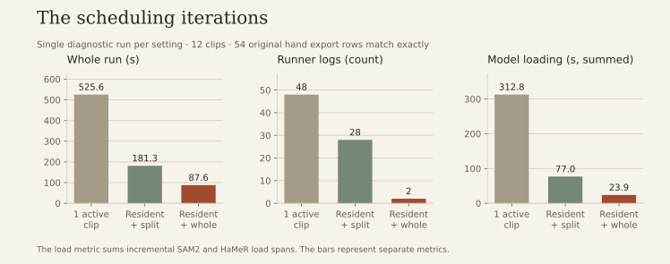
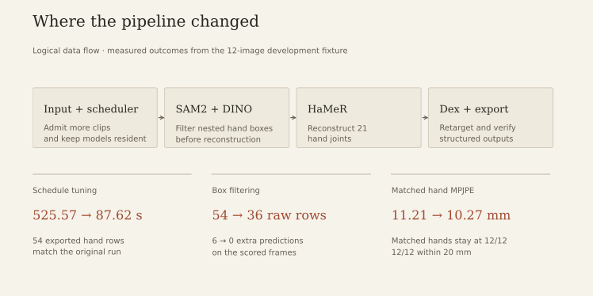
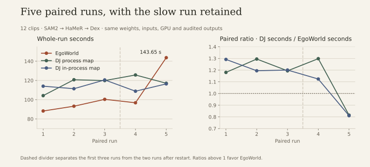
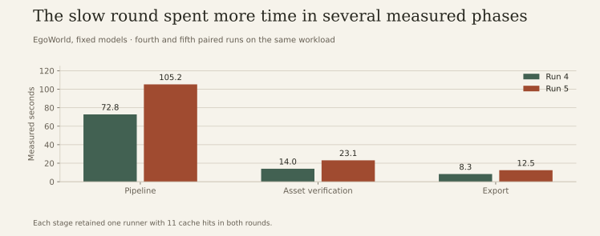
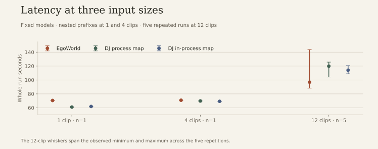
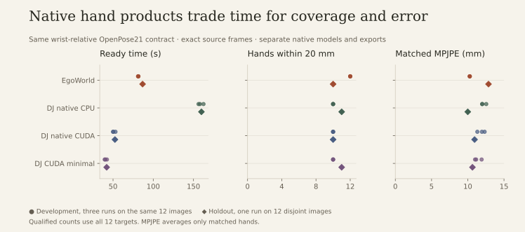

# EgoWorld 效率收敛：正式比较与交接

在 RTX 4060 Laptop 8 GB 上，原来 525.57 秒的手部流程经调度调整降至 87.62 秒，原 54 条输出逐值一致。正式测试发现，EgoWorld 的优势出现在 **12 个片段、同模型、需同时输出手和机器人关节** 的条件；1 个片段时启动开销更显著。原生 GPU Data-Juicer 在只需手部关节时更快，也在留出图像上取得较低的平均关节误差。

正式结果包含 13 组、45 次有效执行，其中固定模型 21 次，原生产品 24 次。测量代码为 `30bf1608f2d74a1bf04e7f16909de76c4ce11a01`。所有已完成组均通过输入、源码、配置和产物审计。主要目标服务器为 2–16 卡，本报告的耗时均来自单卡本机。[机器可读结果](benchmarks/efficiency-convergence-2026-11-04.json)

CPU/Ray 回归记录为 345 项通过，另有 11 项环境或原生模型 smoke 未选中。真实模型和产物由本报告的正式运行独立验证。

可在本地项目站阅读图表和 45 次执行的逐次表格。CSV 对每次执行保留两种评分口径，共 90 行，包含时间、匹配、漏检、额外预测、MPJPE、PCK、达标率和资源观测。两个评分行共享同一次执行的时间和资源值。[展示页预览方式](../website/README.md) · [逐次 CSV](assets/benchmarks/trials.csv) · [正式 JSON](benchmarks/efficiency-convergence-2026-11-04.json) · [诊断数据和来源哈希](benchmarks/efficiency-iterations-2026-11-04.json)

## 525 秒从哪里来

原 recipe 墙钟 525.57 秒中，pipeline 为 500.84 秒、资产身份核验 17.79 秒、导出 4.84 秒。12 个片段逐个完成，使 SAM2 和 HaMeR 反复切换。记录的增量加载累计为 SAM2 68.65 秒、HaMeR 244.19 秒，约占入口时间的 60%；HaMeR 前向只有 5.73 秒。嵌套 worker/request/roundtrip 时间互相重叠，不能相加当墙钟。

| 调度试跑 | 整链秒 | 模型 runner 记录 | 手部输出 |
| --- | ---: | ---: | --- |
| 单活动片段，拆分 | 525.57 | 48 | 54 条基线记录 |
| 12 活动片段，驻留窗口 24，保留拆分 | 181.33 | 28 | 54 条逐值一致 |
| 12 活动片段，驻留窗口 24，整阶段，有界提交 | 87.62 | 2 | 54 条逐值一致；两个模型各 11 次命中 |

从第一到第三轮，墙钟减少 83.3%，SAM2 与 HaMeR 的累计增量加载从 312.84 秒降至 23.93 秒。第二轮的对应数值为 76.97 秒。三个指标分别计量。

最后一组未减少输入帧、改变模型精度或复用旧预测。队列、预算与阶段拆分共同调整；不能把全部收益归因于一个配置项。正式五轮的 SAM2、HaMeR、Dex 各只有一个常驻 runner，每个阶段处理 12 个片段、命中 11 次。每个片段的 `runner.log` 指向常驻日志；它们不代表每片段启动模型。

## 多余预测与质量保护

手与前臂常形成包含框。新增可选同类包含重叠过滤，按交集与较小框面积之比（IoM）去重，可优先保留较紧框；不限制最大手数，默认关闭。开发集曾试过把置信度从 0.22 提到 0.35，虽然去掉了多余预测，却漏掉真实左手及双手视频中的左手，因此弃用。

正式条件保留 0.22，使用 `min_box_area=1024`、`containment_iom=0.9`、`containment_prefer="smaller"`。开发集 54→36 条原始预测，评分帧覆盖 12/12、额外预测 6→0，手根 MPJPE 11.21→10.27 mm，20 mm 达标 12/12。已知左手视频 6/6 帧有左手，双手视频 6/6 帧各有左右手。面积阈值依赖分辨率，包含框规则可能影响交叠手。使用前应在目标视频抽检，不能当通用默认值。留出组一律使用事前冻结的设置。

调度对照和过滤对照有各自的输出要求。调度试跑保留 54 条原始导出并验证逐值一致。过滤试跑减少候选框及后续手部重建，使用同一开发集的真值检查覆盖和误差。

## 同模型整链：输出逐值一致

两边都处理同一批视频，执行准备、SAM2→HaMeR→Dex、质量检查和正式导出。Data-Juicer 使用真实 `DefaultExecutor` 执行三个共享模型算子；进程 map 与同进程 map 均为一张可见 GPU，模型权重、参数、线程和外部运行时一致。没有使用旧预测。七组固定模型实验中，掩码、实例、轨迹、手部姿态、机器人映射及两个正式导出均逐值相同，数组与 QC 也相同。独立用 URDF 零容差核验 195 条参考机器人记录，精确一致性覆盖三边共 585 条；越界为零，Pinocchio 指尖 FK 有效。这个检查覆盖关节范围与运动学，不评估机器人动作与真值的偏差或碰撞。

| 12 片段重复 | EgoWorld（秒） | DJ 进程 map（秒） | DJ 同进程 map（秒） |
| --- | ---: | ---: | ---: |
| 1 | 88.29 | 104.23 | 114.05 |
| 2 | 93.26 | 120.76 | 111.42 |
| 3 | 100.38 | 119.88 | 120.54 |
| 4 | 96.82 | 125.68 | 108.83 |
| 5 | 143.65 | 117.08 | 116.44 |
| **中位数** | **96.82** | **119.88** | **114.05** |

按各轮配对计算 `DJ 秒 / EgoWorld 秒`，两种 DJ 配置的中位数均约 **1.19×**，观察范围分别为 **0.82–1.30×** 和 **0.81–1.29×**；两种配置下 EgoWorld 均快于 4/5 轮。第五轮保留：相较第四轮，pipeline 72.78→105.23 秒、资产身份核验 14.04→23.12 秒、导出 8.31→12.46 秒。SHA 核验数据量相近，SAM2/HaMeR 单次加载更慢，HaMeR 前向未变慢，常驻和命中次数相同。主机层面的具体诱因未被隔离，不能据此断定磁盘或温度原因。

| 输入规模 | EgoWorld 三核 | DJ 进程 map | DJ 同进程 map |
| --- | ---: | ---: | ---: |
| 1 片段（单次） | 70.49 | 61.03 | 61.87 |
| 4 片段（单次） | 70.85 | 69.80 | 69.28 |
| 12 片段（五轮中位数） | 96.82 | 119.88 | 114.05 |

1 与 4 片段使用嵌套图像前缀，只作边界探索。三个数据点不能确定精确交叉点或服务器扩展曲线。

## 原生产品：比较同一种数据的质量与成本

统一输出 OpenPose21、米制手根坐标、相机轴向及左右手标记。统一导出保留全部预测与重复采样槽位。不同模型的输出值允许不同。独立 GT 按图像腕点匹配，在 20/50 mm 阈值下保留所有漏检；MPJPE 为已匹配手的平均误差。FreiHAND 是单目标右手任务，EgoWorld 使用右手先验；不能从该任务推出自动左右手识别精度或泛化。模型先验尺度也不能当标定后的世界坐标。

原生 CPU 使用原有环境和默认算子资源。另建原生 CUDA 环境让 WiLoR 自行选择 GPU，时长和分辨率过滤仍由 CPU 执行。默认输出包含网格/可视化；最少输出配置仅通过已有选项关闭这两项。三种参考分别报告。相同输入字节、真值和评分门槛不代表两边推理或附属导出工作量相同，因此此处不给框架加速比。

| 12 图开发集，三轮中位数 | 整链秒（最小–最大） | 统一输出就绪秒 | 精确帧覆盖 | 20 mm 达标 | 达标手/秒（统一输出） |
| --- | ---: | ---: | ---: | ---: | ---: |
| EgoWorld | 81.03（80.63–81.19） | 81.46 | 12/12 | 12/12 | 0.147 |
| 原生 CPU | 156.78（155.04–161.26） | 158.05 | 11/12 | 10/12 | 0.063 |
| 原生 CUDA 默认 | 49.09（48.83–51.84） | 50.31 | 11/12 | 10/12 | 0.199 |
| 原生 CUDA 最少输出 | 39.20（38.43–41.17） | 40.42 | 11/12 | 10/12 | 0.247 |

开发集 EgoWorld 评分帧无额外预测，原生条件各有 1 条。按上表顺序，开发集的匹配手 MPJPE 中位数为 10.27、12.00、11.95、11.16 mm。留出组的误差排序反转。

| 12 张留出图，单次 | 统一输出就绪秒 | 精确帧覆盖 | 已匹配 MPJPE（mm） | 精确帧 20/50 mm 达标 | 相同图像补充口径 20/50 mm 达标 |
| --- | ---: | ---: | ---: | ---: | ---: |
| EgoWorld | 86.73 | 12/12 | 12.86 | 10/12、12/12 | 10/12、12/12 |
| 原生 CPU | 159.87 | 11/12 | 10.00 | 11/12、11/12 | 12/12、12/12 |
| 原生 CUDA 默认 | 52.38 | 11/12 | 10.94 | 10/12、11/12 | 11/12、12/12 |
| 原生 CUDA 最少输出 | 42.09 | 11/12 | 10.64 | 11/12、11/12 | 12/12、12/12 |

四种留出条件在评分帧均有 1 条额外预测。原生采样漏掉一帧并重复末帧；精确源帧是主口径，漏帧计为漏检。相同静态图像补充口径仅对解码像素相同的重复帧适用，不按预测误差挑帧。1 图的原生三种配置都有产出，但精确帧覆盖 0/1、补充口径 1/1；这来自采样位置，不是清洗拒绝。相同静态图像口径不能推广到运动视频。统一输出时间计入全部预测规范化及原生帧身份恢复，GT 审计另计。

| 开发集前缀整链耗时 | EgoWorld | 原生 CPU | 原生 CUDA 默认 | 原生 CUDA 最少输出 |
| --- | ---: | ---: | ---: | ---: |
| 1 图，单次 | 63.48 s | 38.69 s | 36.40 s | 37.32 s |
| 4 图，单次 | 68.04 s | 77.16 s | 40.21 s | 36.71 s |

原生 CPU 在 1 图试跑中用时更短，4 图试跑和 12 图重复中位数则是 EgoWorld 用时更短。两个前缀点各测一次。

因此，本地已测的优势区间是 **多片段、同时需要掩码/轨迹与手和机器人关节的共享模型流程**；原生 CPU 条件下 12 图的手部任务也有时延和达标产出率优势。纯手部任务使用原生 GPU 时，它在两组数据上更快；留出集上原生模型的几何误差更低。原生与固定模型组各自的产物、质量和速度应分别选用。

## 输出产物与验收范围

| 逐值核验对象 | 产物 | 验收口径 |
| --- | --- | --- |
| SAM2 阶段 | `masks.parquet`、`instances.parquet`、`tracks.parquet` | 掩码数组、实例字段和轨迹字段逐值一致 |
| HaMeR 阶段 | `hand_pose.parquet` | 三方手部姿态的数值和字段一致 |
| Dex 阶段 | `mapping.parquet` | 映射字段逐值一致，独立核验参考行的关节限位与指尖 FK |
| 正式导出 | `hand_joints.parquet`、`robot_joints.parquet` | 对应数据类型的输出字段一致，比较忽略行顺序 |

每个 12 片段固定模型执行在上述每类产物中各有 36 行。1 与 4 片段执行对应 3 与 12 行。每个产物类别共覆盖 195 条参考记录与三方执行的 585 条记录。原生手部轨道按共同的 OpenPose21 契约验收，逐次导出行数、资源观测和两个评分视图均在数据表中。全设备 GPU 峰值包含其他进程占用，进程树 RSS 表示主机内存观测。[逐次 CSV](assets/benchmarks/trials.csv) · [正式 JSON](benchmarks/efficiency-convergence-2026-11-04.json)

## 复现与服务器迁移

- 输入、设置与结果：`/mnt/d/EgoWorld/runs/efficiency-goal-20261103/`。`formal-plan-v1/preregistration.json` 是事前冻结计划；`recovery-study-v1/combined` 是完整报告入口。原中断尝试、两次试跑设置和被弃用的置信度方案均保留。
- 环境中断发生在第四轮中。校验 217 个冻结文件和 15 项模型/运行资产后，完整复核留出及前三轮，复用 13 次；用新目录补跑 32 次，第四轮旧尝试不进入配对统计。五轮包含重启前三轮、重启后两轮，配对均在各自组内比较。重复衡量同一批图像下的运行波动，不能当更多独立图像或一个连续热状态。
- 汇总复算：`.venv/bin/python egoworld/experiments/convergence_analysis.py --study <完整目录> --output <新目录>`。加 `--plots` 生成图表（需要 matplotlib）。完整组和固定模型逐值审计是产生比值的前提。真实数据、MANO 与模型权重按许可保管，不随仓库发布。
- 在自己的已配置模型文件中合并经过验证的调度设置：`execution.max_active_clips=12`、`model_residency_tasks=24`、`max_stage_wait_s=300`、`split_execution=false`；`backpressure.max_in_flight_write=16`、`max_in_flight_bytes=1073741824`、`max_prepared_bytes=134217728`。这些是短片段单卡参考，不应直接复制到长视频或所有服务器。输出仍由 `egoworld data plan/run --recipe ...` 选择；需要手和机器人关节时选择 `hand_joints` 与 `robot_joints`。包含框和面积过滤独立配置。
- 2/4/8/16 卡配置包在 `server-prep-convergence-v1`，每个卡数有共享 GPU 池与固定阶段分组，共 8 套，均通过结构校验。64 CPU/256 GiB 是规划示例；按实际预算重新生成，迁移时重建模型环境、检查权重，再逐卡 smoke 和 2 卡并发验收。[服务器交接](handoff-server-comparison-20261102.md) 记录命令和资产。用足够独立片段填满各卡，基于同卡数、同输入和同输出比较。固定阶段池可能减少切换，也可能因负载不均空转；多卡清洗收益仍待实测。

下一轮服务器测试可优先分离严格资产哈希、模型首次加载和稳态队列的成本，在等质量条件下比较可信资产登记、GPU 池和阶段分组。GPU 计算适用于模型处理和确实适合 GPU 的清洗环节；没有把原生 CPU 清洗改派 GPU，也没有当前多卡收益的实测结论。远端传入的 `docs/handoff.md` 保持原样。
