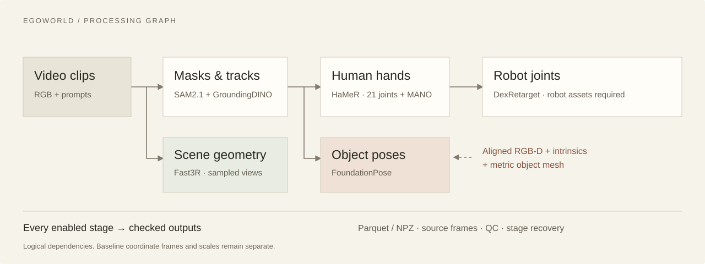

# Architecture

EgoWorld is an offline annotation system for a single server. It orchestrates existing perception models and writes structured, inspectable results. It is not a new perception model or a robot control policy.

The [editable Mermaid source](../assets/pipeline-simple.mmd) captures the same dependencies. The SVG is the presentation asset used in the README and website.

## Processing graph

1. **Prepare video.** Build source and clip manifests and retain source frame/time identity.
2. **Segment and track.** GroundingDINO supplies prompted detections; SAM2.1 supplies masks. Outputs include instance records, boxes, and clip-local 2D trajectories.
3. **Follow the enabled branches.** HaMeR consumes hand detections; DexRetarget consumes hand joints. FoundationPose consumes object masks plus aligned RGB-D, intrinsics, and metric mesh assets. Fast3R consumes sampled RGB views independently of segmentation.
4. **Commit and inspect.** Enabled stages write Parquet tables or NPZ geometry, metadata, and quality checks. The run retains events and a summary for inspection and recovery.

The diagram shows logical dependencies. It does not imply that every model is simultaneously resident on the GPU, all stages run for every clip, or every output is in one world frame.

## Execution and recovery

The public baseline uses bounded admission, completion-driven scheduling, reusable model runners, waiting protection, and separate execution/writer work. Model environments are isolated where dependencies conflict. Resource limits describe admission policy; they are not an operating-system memory guarantee.

A stage is reusable only after its commit metadata, files, hashes, and schema validate. Changes invalidate affected descendants while independent branches can remain reusable. A completed file alone is insufficient evidence of a valid stage.

| Mechanism | Meaning | Publication state |
| --- | --- | --- |
| Run recovery | Reuse valid committed stages within an unchanged run | Public baseline |
| Cross-run stage cache | Reuse matching model results across output recipes | Development prototype |
| Prepared-input cache | Reuse decoded frames or crops within bounded budgets | Separate development branch |

See the [status ledger](status.md) for the branch boundary and the [research plan](research-plan.md) for evaluation.

## Output contracts

| Family | Coordinate / identity contract | Important boundary |
| --- | --- | --- |
| Masks, boxes, tracks | Source-image pixels and clip-local identity | No cross-video identity guarantee |
| Human hands | Model-specific geometry, handedness, and camera terms | A body-model prior is not measured metric scale |
| Object poses | Object-to-camera transform, with metric assets | Requires aligned depth and correct units |
| Robot joints | Joint names, units, and robot identity | World placement additionally needs base calibration |
| Scene geometry | Reconstruction frame, sampled cameras, and points | Relative scale unless independently calibrated |

Source frame indices allow a temporal join. A geometric join additionally needs compatible units, transform direction, calibration, and coverage. Never silently extrapolate a sampled camera pose to an unmatched frame.

The developing world-export layer uses measured scale evidence and an explicit reference frame. World hand exports additionally need metric hand correspondences. This is distinct from globally mapping an entire video or aligning multiple clips.

## Deliberate scope

Prioritize reproducible processing, reuse, resource accounting, and interpretable outputs. Multi-node orchestration, a general plugin marketplace, arbitrary user DAGs, online robot control, and new model families are outside the immediate roadmap.

Implementation references: [scheduling design 中文](../design.md), [output fields 中文](../outputs.md), and [server operation 中文](../server.md).
