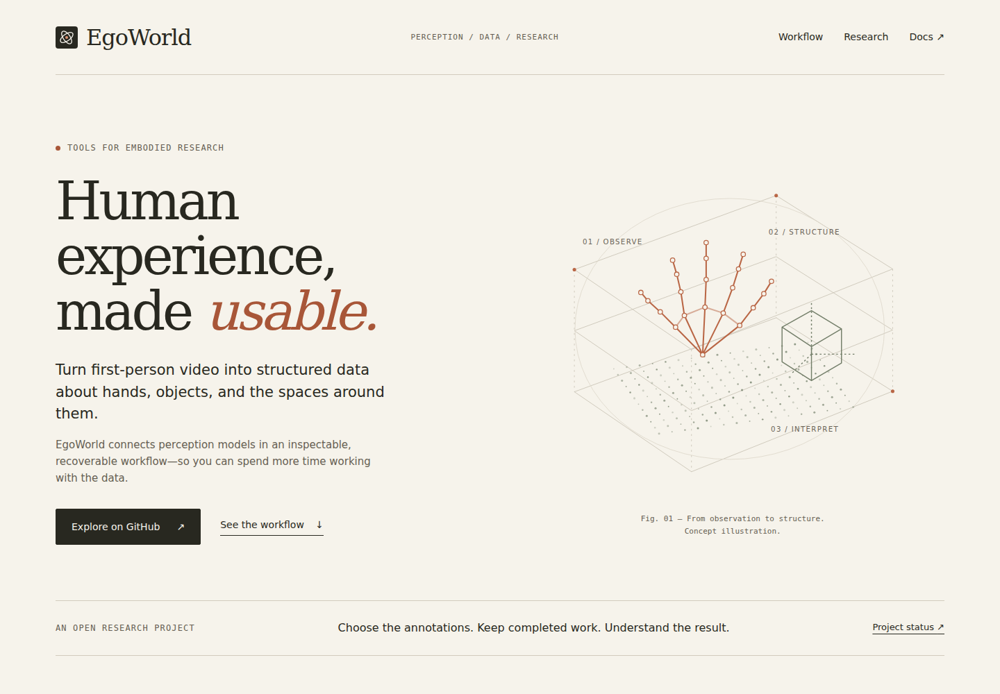

# Website direction

**Positioning:** Structured data from human experience.

The site should feel like a thoughtful research project with a usable engineering foundation: calm, precise, and easy to read. Visual polish must not imply that experimental capabilities or unmeasured performance are already established.

## Reference study

Reviewed on 2026-11-02:

| Reference | Useful principles | EgoWorld adaptation |
| --- | --- | --- |
| [Physical Intelligence](https://www.pi.website/) | Warm neutral canvas, compact navigation, a clear research proposition, chronological research reading | Direct language, modest navigation, numbered research notes, visible links to evidence |
| [Anthropic](https://www.anthropic.com/) | Warm paper tones, generous spacing, a strong editorial hierarchy, distinct research/product destinations | Large serif headlines, quiet supporting copy, clear paths to workflow, research, and documentation |

Reference pages informed hierarchy and tone. EgoWorld uses its own layout, copy, mark, and SVG drawings; no company marks, site assets, proprietary fonts, or implied affiliations are reused.

## Visual system

| Token | Value / role |
| --- | --- |
| Paper | `#f6f3eb` — default canvas |
| Ink | `#282820` — headings and primary controls |
| Muted | `#655e52` — secondary text |
| Rule | `#d2cbbd` — fine dividers |
| Terracotta | `#a85638` — emphasis and link feedback |
| Sage | `#e8ece2` — evidence/status section |
| Display | Georgia / Times New Roman; regular weight, tight spacing |
| Body | Arial / Helvetica; readable at 14–21px |
| Labels | Courier New; restrained small labels |
| Content width | Maximum 1280px; 48px desktop and 20px mobile side space |
| Rhythm | Large section gaps, thin rules, minimal corner rounding |

Use original line drawings of hands, objects, and scene samples. Distinguish conceptual illustrations from actual inference. Avoid decorative gradients, glass effects, endless feature tiles, oversized badge walls, fabricated proof, and animation that competes with reading.

## Page map

1. **Proposition.** A clear headline, concise explanation, original conceptual illustration, GitHub and workflow links.
2. **Outputs.** Five expandable rows show model, data, prerequisites, and coordinate meaning.
3. **Workflow.** A simple dependency diagram with recovery and inspection explained below.
4. **Ideas.** Short entries leading to substantive insight and research documents.
5. **Evidence.** Separate public baseline, development work, and unestablished results.
6. **Start.** Link to installation instructions and repository; retain credits and licensing information.

GitHub README uses the same colors and SVG vocabulary with a shorter narrative. It remains useful without custom CSS. The full website uses native HTML structure and responsive styles.

## Implementation handoff

The [website prototype](../website/README.md) is dependency-free static HTML/CSS. Keep it static while the main purpose is to explain the project. Introduce a framework only when substantive content routing, search, or application behavior warrants it.

Near-term additions should follow actual artifacts: an approved inference sample gallery, reproducible benchmark notes, research updates, and a paper link when one exists. Each real sample should include input provenance, configuration, outputs, failure modes, and a clear distinction between inference and illustration.

## Before hosting

- Reconcile every capability claim with the published code revision and evidence ledger.
- Confirm mobile reading, keyboard focus, expandable rows, links, and diagram zoom/scroll behavior.
- Keep local assets portable; confirm the built site works under a project subpath.
- Select the real domain/host, then add canonical URL, social image URL, and sitemap as appropriate.
- Enable the supplied deployment workflow only when website publication is intended.
- Set repository About URL to the verified website, not a planned address.

Hosting is intentionally left for the later website phase requested in the brief.
